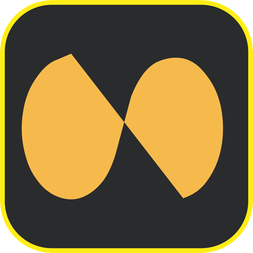

# Notcha 3.2.1

> A dynamic-island style desktop notch companion for Windows and macOS with focus timer, media player, app shortcuts, clipboard history, power controls, and high-speed Wi-Fi file transfers.



---

## 🍎 Apple Silicon (`arm64`) & Universal macOS Support

**Does the macOS release support Apple Silicon?**
**Yes, 100% natively!**

- **Native Apple Silicon Architecture**: Notcha 3.2.1 includes a dedicated native Apple Silicon build (`Notcha-3.2.1-arm64.dmg` and `Notcha-3.2.1-arm64-mac.zip`) optimized specifically for Apple's M-series chips (M1, M2, M3, M4 and their Pro/Max/Ultra variants).
- **Universal Mach-O Helper Binaries**: Both native companion binaries—`media-helper` (MediaRemote and CoreAudio controller) and `dock-helper` (Dock icon tracking and live window preview capture)—are compiled as **Universal Mach-O binaries** containing both `arm64` and `x86_64` executable slices.
- **Zero Rosetta 2 Overhead**: Runs directly on bare metal without needing Apple's Rosetta 2 translation layer, ensuring maximum battery efficiency, instant startup, and zero CPU emulation overhead.
- **Intel Mac Support**: Intel-based Macs continue to be fully supported via native `x64` binaries (`Notcha-3.2.1.dmg` and `Notcha-3.2.1-mac.zip`).

---

## 🆕 What's New in Version 3.2.1

- 🛠️ **Fixed Drag & Drop File Path Resolution (`webUtils.getPathForFile`)**:
  - In modern Electron, Chromium strips `File.path` on HTML5 drag-and-drop objects, which previously caused dropped files from macOS Finder to fail silently (only clicking "Browse" worked).
  - Implemented `webUtils.getPathForFile` bridge across all windows (Send window, Receive window, Mini App, and top notch). Dragging files directly from Finder or Windows File Explorer now instantly registers file paths and delivers files seamlessly.

- 🏷️ **Accurate Device Identification & System Logos**:
  - Replaced ambiguous model guessing with clean, 100% accurate device naming: displays `${ip} | [System Logo / Name]` (e.g. `10.57.89.44 | 🤖 Android`, `10.57.89.78 |  iOS`, `10.57.89.92 | ⊞ Windows`, `10.57.89.155 |  macOS`, `10.57.89.210 | 🐧 Linux`).
  - Preserves custom device names when set.

- 📊 **Real-time Progress Tracking for Large File Transfers**:
  - Added live chunk-based transfer progress tracking for both **Sending** (PC to phone) and **Receiving** (phone to PC).
  - Displays dynamic percent bars, formatted transfer sizes (`45 MB / 1.4 GB`), and target device info across the Send window, Receive window, and the top notch Transfer tab.
  - Mobile web portal displays live upload progress and download notifications with 1.2s rapid sync.

- ⚡ **Universal Mach-O Binaries**:
  - `media-helper` and `dock-helper` native Swift binaries compiled with dual `arm64` and `x86_64` architecture slices via `lipo`.

---

## 🌟 Master Feature Catalog (All Features)

### 🏝️ Dynamic Desktop Island (Notch)
- **Top-Center Floating Island**: Sleek status pill hanging elegantly at the top of your display, mirroring modern mobile dynamic islands.
- **Fluid Spring Animations**: Expands smoothly when clicked or hovered to reveal quick controls, audio visualizers, and notification badges.
- **Interactive Pill Indicators**: Centered clock that smoothly glides to make room for active music waves, focus timer countdowns, and DND status indicators.
- **Always-on-Top & Auto-Hide**: Option to keep the island pinned open while multitasking or let it collapse into a subtle hover bar.
- **Global Hotkey**: Press `Cmd/Ctrl + Alt + N` to toggle island visibility from anywhere.

### 🚀 Independent Floating Windows for File Transfers
- **Dedicated Send Window (`Notcha • Send Files`)**:
  - Movable, resizable dropzone station with an always-on-top pin.
  - Live paired device tray showing reachable phones and computers.
  - Multi-file queue tray with individual file badges and quick removal buttons.
  - 1-click send dispatch with live chunk progress feedback.
- **Dedicated Receive Window (`Notcha • Received Transfers`)**:
  - Independent incoming transfer manager with live incoming transfer alerts.
  - Auto-accept incoming files toggle.
  - Custom download folder picker with persistent settings.
  - Categorized gallery view (**All**, **Images**, **Videos**, **Documents**, **Archives**).
  - Search filter and 1-click "Reveal in Finder / Explorer" shortcuts.
- **Standalone Mini App**: Compact popup transfer utility that can be detached from the top notch and docked back at any time.

### 📱 Local Network Wi-Fi Transfer & QR Pairing
- **High-Speed Zero-Config Wi-Fi Server**: Built-in HTTP and WebSocket transfer engine running on local port `53317`.
- **Instant Mobile Pairing via ISO 18004 QR Code**:
  - 256x256 high-contrast QR code generated strictly adhering to ISO/IEC 18004 specifications with Level M Reed-Solomon Error Correction.
  - Instantly recognized by iPhone Camera, Samsung One UI Camera, Xiaomi HyperOS Camera, and Google Lens.
  - Padded modal view preventing edge clipping against rounded island borders.
- **No Mobile App Required**: Scanning opens a responsive, touch-friendly web portal in Safari or Chrome for immediate two-way file transfers without installing third-party apps.

### 🎚️ Multi-App Volume Mixer & CoreAudio Routing
- **Per-Application Volume Controls**: Independent volume sliders and mute toggles for active media applications (Spotify, Apple Music, Chrome, Brave, Safari, VLC, QuickTime, Telegram, Discord).
- **CoreAudio Output Device Switcher**: Switch master system audio output between AirPods, Bluetooth headphones, built-in MacBook speakers, USB DACs, and HDMI monitors right from the island.
- **Master Volume Synchronization**: Real-time bidirectional synchronization with hardware volume keys and macOS System Settings.
- **Drag Lock Protection**: Interactive dragging lock prevents background polling from overriding active slider adjustments.

### 🎵 Active Media Hub & Now Playing
- **Smart Active Player Detection**: Intelligently identifies whichever application is currently emitting audio.
- **Live Media Controls**: Play, pause, skip forward/backward, and scrub playback via native seek sliders.
- **Rich Track Metadata**: Displays album artwork, song title, and artist name with animated sound-wave visualizers.

### 🖼️ macOS Dock Icon Window Previews
- **Hover Window Previews**: Hovering your cursor over any app icon in the macOS Dock displays live window thumbnails anchored above the Dock.
- **Window Management**: Click any preview thumbnail to bring that window directly to the front, or close it via the preview card close button.
- **Dock Status Badges**: Amber badges indicate minimized windows with restore hints.

### ⏱️ Productivity Focus Timer & Alarms
- **Pomodoro Focus Timer**: Configurable work sessions and rest intervals with progress ring animations.
- **Audio Chimes & Notifications**: Audible chimes and visual island alerts upon session completion.

### 📋 Clipboard History Manager
- **Continuous Clipboard Tracking**: Automatically captures copied text snippets.
- **Instant Search**: Search through previous clips with real-time filtering.
- **1-Click Copy & Paste**: One-click re-copying with visual confirmation feedback.

### ⚡ Quick App Launcher & System Power Controls
- **Favorite App Shortcuts**: Instant launchers for Browser, Terminal, VS Code, Finder/Explorer, Music, Calculator, Notes, and Settings.
- **Custom URL/Command Launcher**: Type any URL (e.g., `github.com`) or file path to launch immediately.
- **System Power Actions**: Fast access to Lock Screen, Sleep, Restart, and Shut Down with safety confirmations.

---

## 🔧 Comprehensive Bug Fixes Log

| Version | Category | Issue Description | Resolution |
| :--- | :--- | :--- | :--- |
| **3.2.1** | **File Transfer** | HTML5 drag-and-drop from Finder failed to provide file paths. | Implemented Electron `webUtils.getPathForFile` across all preload bridges. |
| **3.2.1** | **File Transfer** | Lack of progress feedback during multi-gigabyte transfers. | Added real-time chunked transfer tracking and live progress meters in all windows. |
| **3.2.1** | **Device Pairing** | Device model names were inaccurate or showed generic placeholders. | Formatted as `${ip} \| [System Logo]` (`🤖 Android`, ` iOS`, `⊞ Windows`, ` macOS`). |
| **3.2.1** | **Apple Silicon** | Swift helper binaries were x86_64 only, requiring Rosetta 2. | Recompiled `media-helper` and `dock-helper` as Universal Mach-O binaries (`arm64` + `x86_64`). |
| **3.0.1** | **QR Code** | QR code in mobile connect sheet was cut off at the bottom. | Added centered flex containers with 16px bottom padding and responsive SVG scaling. |
| **3.0.1** | **Dock Previews** | Window preview height clipped the bottom edges of preview cards. | Expanded preview height to 252px and adjusted card aspect ratio constraints. |
| **3.0.1** | **Permissions** | App froze on startup (`--:--`) waiting for accessibility permissions. | Hoisted all DOM bindings, added safe error fallbacks, and made permissions passive. |
| **1.4.1** | **Volume Mixer** | Volume slider snapped back to 80% after dragging. | Added debounce lock and interactive dragging mutex during CoreAudio sync polling. |
| **1.4.0** | **Media Player** | Phantom media tabs appeared for inactive background apps. | Replaced multi-tab carousel with smart single active player detection. |
| **1.3.2** | **App Packaging** | ASAR unpacking errors for Swift scripts. | Explicitly declared `asarUnpack` for all native helper binaries in `package.json`. |

---

## 📦 Downloads & Installation

### macOS
- **Apple Silicon (M1/M2/M3/M4)**:
  - **DMG Installer:** `Notcha-3.2.1-arm64.dmg`
  - **ZIP Archive:** `Notcha-3.2.1-arm64-mac.zip`
- **Intel (x64)**:
  - **DMG Installer:** `Notcha-3.2.1.dmg`
  - **ZIP Archive:** `Notcha-3.2.1-mac.zip`

### Windows (10 & 11, 64-bit)
- **NSIS Installer:** `Notcha Setup 3.2.1.exe`
- **ZIP Archive:** `Notcha-3.2.1-win.zip`

---

## 🚀 Getting Started

1. Ensure **Node.js LTS** is installed.
2. Navigate to the `electron` directory:
   ```bash
   cd electron
   npm install
   npm start
   ```

### Building From Source
```bash
# Build macOS (Apple Silicon + Intel)
npm run dist:mac

# Build Windows (NSIS Installer + ZIP)
npm run dist:win
```
Outputs are generated in `electron/dist/`.
