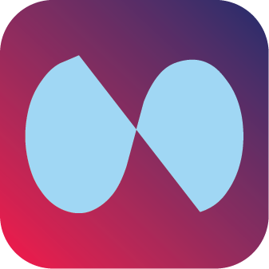

# Notcha 1.3.2

> A dynamic-island style desktop notch companion for Windows and macOS with focus timer, media player, app shortcuts, clipboard history, and power controls.



## What's New in 1.3.2

- 🛡️ **Power Safety Confirmation Modal**:
  - **Shut Down**, **Restart**, and **Sleep** now bring up an explicit warning confirmation card with pulsing alert badges and dedicated confirmation buttons (*"Shut Down"*, *"Restart"*, *"Sleep PC"*) alongside *"Cancel"* to prevent accidental clicks.
  - **Fail-safe dismissals**: Pressing Escape, switching tabs, or unhovering automatically dismisses the warning safely.
  - **Instant screen lock**: Uses native macOS `SACLockScreenImmediate()` to lock immediately to the password prompt without screensaver delay.

- 🎵 **Unified Active Media Player**:
  - Automatically detects and displays whichever app is actively playing audio (Spotify, Apple Music, YouTube in Brave/Chrome/Safari, VLC, Telegram, etc.).
  - Eliminated sub-tab jumping and removed phantom/idle players: clean single-card view focusing entirely on the playing app.
  - Interactive playback buttons (Play/Pause, Next, Prev, Seek bar, and Volume slider) directly control the active app.
  - Elegant empty state when no media is currently playing.

- 🔕 **System Do Not Disturb (DND) Integration**:
  - Toggles macOS Control Center Focus mode directly and syncs state on startup.

- ⏰ **Centered Island Clock**:
  - The compact notch pill features a beautifully centered clock that smoothly glides to the corner only when companion badges (timer, alarm, DND, audio wave) become active.

- 🚀 **Quick App Shortcuts**:
  - Instant launchers for Browser, Terminal, VS Code, Files/Explorer, Music/Spotify, Calculator, Notes, and Settings.
  - Custom launcher bar: Type any website URL (e.g. `github.com`), file path, or application command to open instantly.

- 📋 **Clipboard History**:
  - Background clipboard tracking of copied text snippets.
  - Instant search filter.
  - 1-click copy back to clipboard with visual feedback badge (`✓ Copied!`).
  - Item deletion and "Clear All" history.

- 🏝 **Dynamic Island UX**:
  - **Compact Pill:** Hanging sleekly from the screen top showing the time, animated sound waves when music plays, and ring timer when focus is active.
  - **Auto-Hide:** Collapses into a thin subtle indicator line that reveals on hover.
  - **Global Shortcut:** `Ctrl/Cmd + Alt + N` to toggle auto-hide from anywhere.
  - **Pin Island:** Keeps the island open while multitasking.
  - Transparent click-through canvas outside the visible island.

---

## Getting Started

1. Ensure **Node.js LTS** is installed.
2. Navigate to the `electron` directory:
   ```bash
   cd electron
   npm install
   npm start
   ```

## Building Executables

Build native installers for macOS (`.dmg`, `.zip`) and Windows (`.exe`, `.zip`):
```bash
npm run dist:all
```
Outputs are generated in `electron/dist/`.
