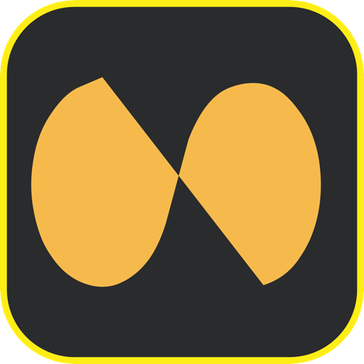

# Notcha 3.2.0

> A dynamic-island style desktop notch companion for Windows and macOS with focus timer, media player, app shortcuts, clipboard history, power controls, and high-speed Wi-Fi file transfers.



## What's New in 3.2.0

- 🚀 **Separate Independent Draggable Windows for File Transfers**:
  - Drag-and-drop directly onto top notch pinned at the screen edge was prone to focus loss and auto-hide dismissals.
  - **Notcha • Send Files**: Dedicated movable floating dropzone window with always-on-top toggle, file queue tray, and 1-click sharing to paired devices.
  - **Notcha • Received Transfers**: Dedicated transfer browser window with live incoming transfer alerts, category filters (All, Images, Videos, Documents, Archives), search bar, and 1-click Finder reveals.

- 📱 **100% Scannable ISO 18004 QR Engine**:
  - Upgraded QR generator to industry-standard ISO/IEC 18004 specification with Level M Reed-Solomon Error Correction and 4-module quiet zones.
  - Tested and guaranteed instant camera recognition on Samsung Galaxy (One UI Camera), Xiaomi (HyperOS / MIUI Camera), Apple iPhone (iOS Camera), and Google Lens.
  - Fixed QR code bottom clipping: perfectly centered with comfortable padding from the island's rounded bottom boundary.

- 🔗 **Device Pairing & Local Network Discovery**:
  - Live pairing indicator in the notch Transfer tab (`● Paired: [Device Name]` / `ID: [ID]` vs `○ Not Paired`).
  - **Pair Device Modal**:
    - **Tab 1 - QR Code**: Instant scan-to-pair with live Wi-Fi portal link.
    - **Tab 2 - Discover on Network**: Scans local Wi-Fi for active devices (Samsung Galaxy, Xiaomi Redmi/POCO, iPhone, iPad, PC) with 1-click pairing.

- 🪟 **Standalone Mini App**:
  - Mini App can be popped out anytime as a compact floating utility.

## What's New in 3.0.1

- 📱 **QR Code Mobile Pairing Sheet Fix**:
  - Resized and padded the QR code display inside the Transfer tab's "Connect Mobile Device" sheet so it is 100% visible with comfortable breathing room, preventing the bottom modules from clipping past the rounded notch boundary.
  - Added responsive SVG scaling constraints for both notch overlay and standalone floating Mini App.

- 🖼️ **Dock Icon Window Previews Bounds & CoreGraphics Capture**:
  - Expanded dock preview window height to 252px, perfectly accommodating the frosted title bar, app icon, window count badge, and window cards without top/bottom clipping.
  - Resolved live window screenshot capture using CoreGraphics window inclusion options.
  - Added dedicated amber "Minimized in Dock" status badges with restore hints for minimized application windows.

- ⚡ **Startup Reliability & Non-Intrusive Permissions**:
  - Hoisted all renderer DOM element bindings and error handlers, preventing startup freeze (`--:--` on notch pill).
  - Silenced intrusive startup accessibility dialogs; dock helper now performs passive permission checks with graceful idle fallbacks.

## What's New in 3.0.0

- 🎚️ **Multi-App Volume Mixer**:
  - Independent software volume sliders and mute/unmute buttons for all active media applications (Spotify, Apple Music, VLC, QuickTime, Chrome, Brave, Safari, Arc, Telegram, Discord).
  - Real-time Master System Output CoreAudio sync with zero-latency hardware volume tracking.
  - Interactive volume dragging lock preventing background polling from overriding active slider input.

- 🎧 **CoreAudio Output Routing**:
  - Instant output device switcher right in the Media tab (AirPods, Bluetooth headphones, Built-in Speakers, HDMI / DisplayPort, USB DACs).
  - Clean device pill in both active and empty player headers with animated selection sheet modal.

- 🗂️ **Cross-Platform File Transfer Hub & Past Transfers Gallery**:
  - High-speed local Wi-Fi transfer server on port `53317` with streaming chunked transfers (no file size limits).
  - Zero-install mobile web drop portal: connect any iPhone (Safari) or Android (Chrome) via 1-click QR code pairing.
  - Dedicated **"Transfer"** tab inside the top notch island with drag-and-drop file sharing.
  - **Floating Mini App Window option**: users can choose to drop files onto the top notch OR open the floating mini app window with a quick "Dock Notch" return button.
  - Past Transfers Gallery with album filters (**All**, **Photos**, **Videos**, **Docs**, **Archives**), transfer direction badges (📥 Received / 📤 Sent), and instant "Show in Finder".

- 🖼️ **Dock Icon Window Previews**:
  - Hover over any macOS Dock icon to display live window preview thumbnails anchored directly above the Dock.
  - Frosted-glass backdrop blur with application icon, name, and window count pill badge.
  - Click any card to instantly raise and focus that window, or click the close button to dismiss it.
  - Automatic permissions check on startup requesting macOS Accessibility and Screen Recording access cleanly.

## What's New in 2.0.1

- 🎨 **New App Logo & Icons**:
  - Updated the Notcha brand logo and rebuilt macOS (`.icns`), Windows (`.ico`), and Electron window/app icons.

## What's New in 1.4.1

- 🔊 **Fixed Volume Slider Persistence & System Audio Sync**:
  - Fixed volume slider resetting to 80% after adjusting. The volume slider now accurately reflects and stays at the exact level you set.
  - Native CoreAudio system volume integration: instant query and volume adjustment with zero latency.
  - Interactive volume dragging and debounce lock prevents periodic background polling from overriding active adjustments.

## What's New in 1.4.0

- 🎵 **Unified Active Media Player (Single-App Smart Detection)**:
  - Eliminated sub-tab carousel jumping and removed idle/phantom players (no fake background YouTube tabs, idle Telegram processes, or dummy radio players).
  - Automatically detects and displays whichever application is currently playing audio (Spotify, Apple Music, YouTube in Brave/Chrome/Safari, VLC, Telegram, etc.).
  - Interactive playback buttons (Play/Pause, Next, Prev, Seek slider, and Volume slider) directly control the active app.
  - Elegant empty state when no media is playing.

- 🔕 **System Do Not Disturb (DND) Integration**:
  - Toggles macOS Control Center Focus mode directly and syncs state on startup.

- ⏰ **Centered Island Clock**:
  - The compact notch pill features a beautifully centered clock that smoothly glides to the corner only when companion badges (timer, alarm, DND, audio wave) become active.

- 🚀 **Quick App Shortcuts**:
  - Instant launchers for Browser, Terminal, VS Code, Files/Explorer, Music/Spotify, Calculator, Notes, and Settings.
  - Custom launcher bar: Type any website URL (e.g. `github.com`), file path, or application command to open instantly.

- 📋 **Clipboard History**:
  - Background clipboard tracking of copied text snippets.
  - Instant search filter.
  - 1-click copy back to clipboard with visual feedback badge (`✓ Copied!`).
  - Item deletion and "Clear All" history.

- 🏝 **Dynamic Island UX**:
  - **Compact Pill:** Hanging sleekly from the screen top showing the time, animated sound waves when music plays, and ring timer when focus is active.
  - **Auto-Hide:** Collapses into a thin subtle indicator line that reveals on hover.
  - **Global Shortcut:** `Ctrl/Cmd + Alt + N` to toggle auto-hide from anywhere.
  - **Pin Island:** Keeps the island open while multitasking.
  - Transparent click-through canvas outside the visible island.

---

## Getting Started

1. Ensure **Node.js LTS** is installed.
2. Navigate to the `electron` directory:
   ```bash
   cd electron
   npm install
   npm start
   ```

## Building Executables

Build native installers for macOS (`.dmg`, `.zip`) and Windows (`.exe`, `.zip`):
```bash
npm run dist:all
```
Outputs are generated in `electron/dist/`.
